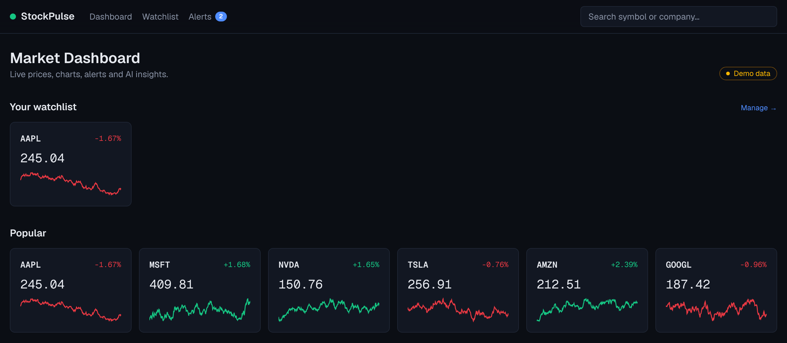
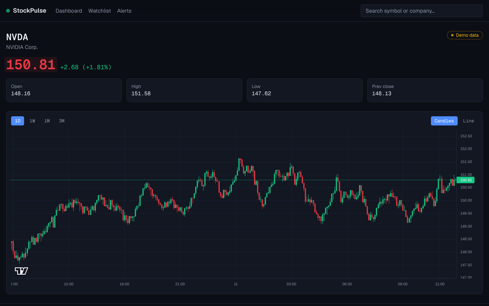
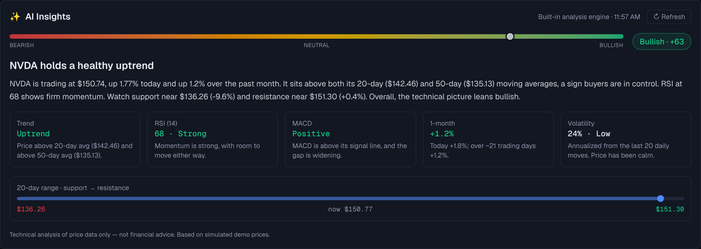
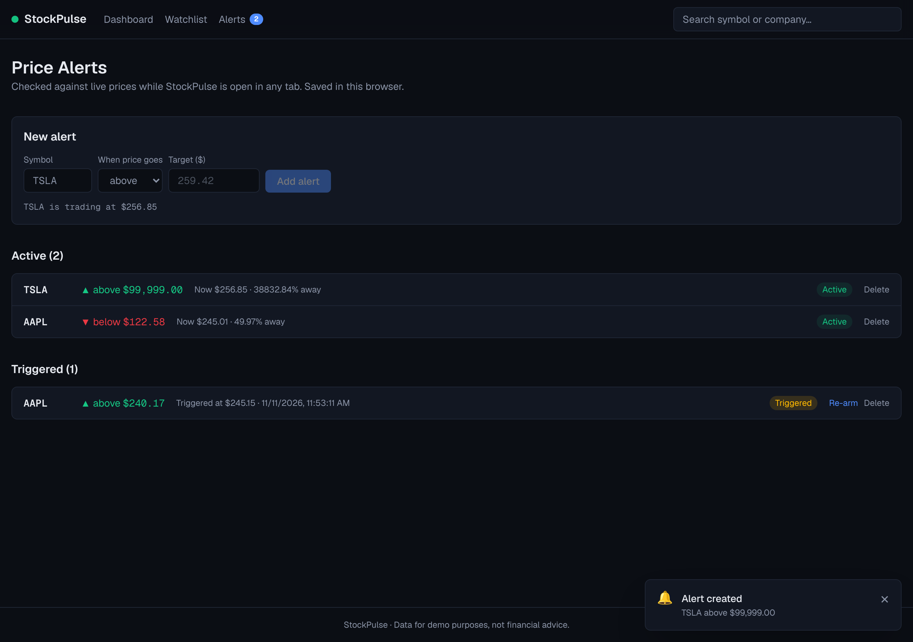

# StockPulse

A real-time stock market dashboard built with **Next.js 16**, featuring live-updating prices, interactive candlestick charts, price alerts with browser notifications, and AI-style technical insights.



## Features

- **Live prices**: quotes refresh continuously and flash green or red on every tick
- **Interactive charts**: candlestick or line view with 1D / 1W / 1M / 3M ranges, built with TradingView's [Lightweight Charts](https://github.com/tradingview/lightweight-charts). The latest candle updates in real time.
- **Symbol search**: search by ticker or company name with keyboard navigation
- **Watchlist**: star any stock; it's saved in your browser and synced across tabs
- **Price alerts**: "notify me when TSLA goes above $260". Alerts fire in-app toasts and browser notifications.
- **AI insights**: a sentiment score, headline and plain-English analysis built from SMA 20/50, RSI, MACD, volatility and support/resistance. You can optionally have Gemini rewrite the narrative from the computed facts.
- **Works without any API keys**: a built-in demo market generates realistic prices, so the app always works

| Live chart | AI insights |
|---|---|
|  |  |



## Tech stack

| | |
|---|---|
| Framework | Next.js 16 (App Router, Cache Components), React 19, TypeScript |
| Styling | Tailwind CSS 4 |
| Charts | lightweight-charts 5 |
| Market data | [Finnhub](https://finnhub.io) (quotes, search), Yahoo Finance (price history), built-in demo generator |
| Insights | Built-in technical-analysis engine, optional Google Gemini |
| Storage | Browser `localStorage` (no database or accounts needed) |
| Hosting | Vercel |

## Getting started

```bash
npm install
npm run dev
```

Open [http://localhost:3000](http://localhost:3000). The app starts in **demo mode**; no keys are needed.

### Optional: real data and AI

Copy `.env.example` to `.env.local` and fill in any of these (all have free tiers):

| Variable | What it enables |
|---|---|
| `FINNHUB_API_KEY` | Real-time quotes and symbol search ([get a key](https://finnhub.io/register)) |
| `GEMINI_API_KEY` | AI-written insight headlines and summaries ([get a key](https://aistudio.google.com/apikey)) |

API keys are only used on the server and are never sent to the browser.

## How it works

- `src/lib/market/`: data layer. `index.ts` picks Finnhub when a key is set, otherwise `demo.ts`, which generates deterministic prices from fractal noise so every server instance agrees. If a live call fails for a symbol, that symbol falls back to demo data instead of breaking the page.
- `src/app/api/`: route handlers for `quotes`, `candles`, `search` and `insights`
- `src/hooks/useQuotes.ts`: client polling (2s in demo mode, 10s on live data to stay within Finnhub's free tier)
- `src/components/AlertEngine.tsx`: mounted once in the layout; checks active alerts against live prices
- `src/lib/insights/`: indicator math, the scoring and summary engine, and the optional Gemini rewrite. The AI receives only computed numbers and is told not to invent any.

## Deploy

Import the repo into [Vercel](https://vercel.com/new). No configuration is needed. You can add the optional environment variables under **Settings → Environment Variables**.

---

*Prices in demo mode are simulated. Nothing in this app is financial advice.*
